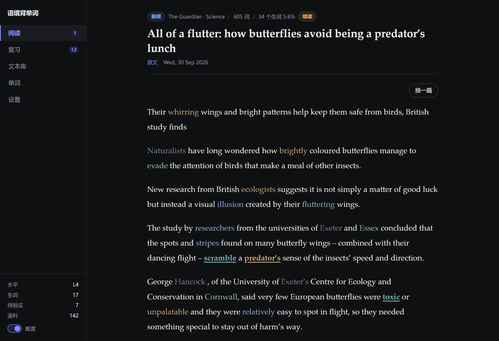
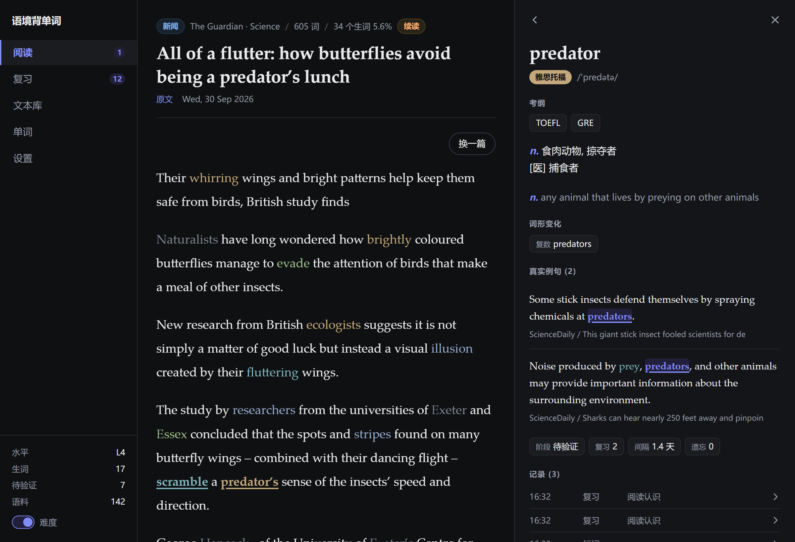
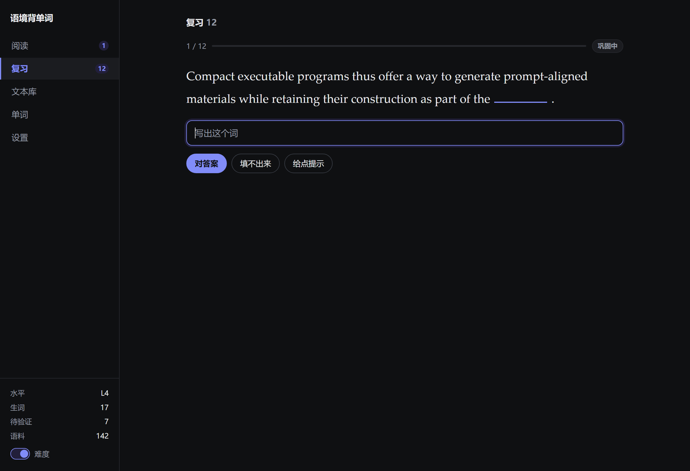
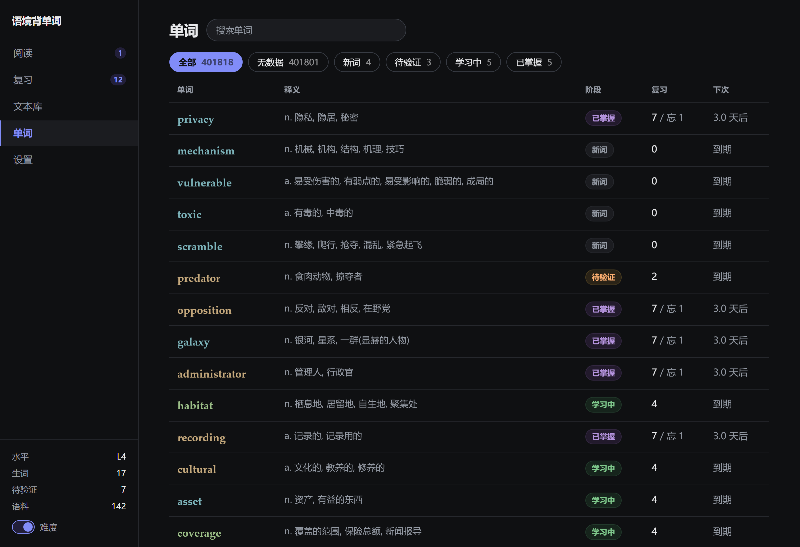
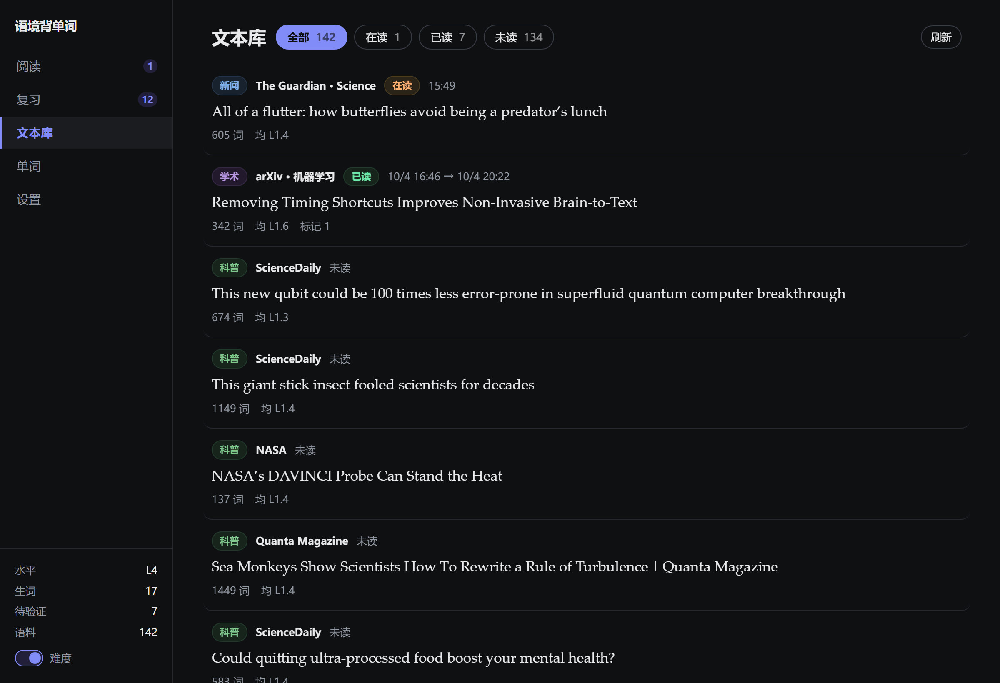
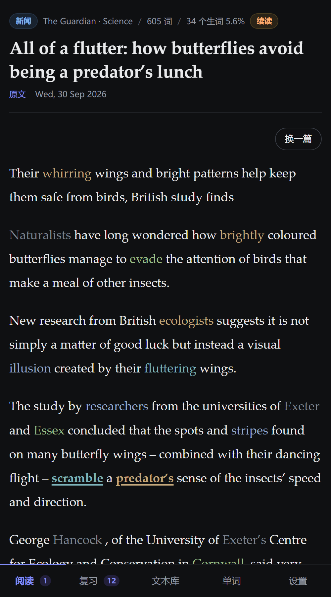

# 语境背单词

在**真实文本**里学习和复习词汇，而不是刷单词卡。

- 读一段真实文章（新闻 / 科普 / 学术），遇到不认识的词点一下 → 看释义 + 这个词**在其它真实文章里的用法**
- 复习也发生在文本里：把词挖空，靠上下文回忆并默写；**优先换用不同于学习时的文章**，让词在新语境里重逢
- 这是刻意的选择：孤立的单词卡只训练「见到这个词能想起中文」，而语境里的重逢训练的是「在句子里读懂它」

---

## 界面

阅读：难度用颜色标出（左下角可整体关掉），已标记的词带下划线。点任意词看释义 —— 以及它在**其它真实文章**里的用法。



| 点词：释义 + 其它文章里的用例 | 复习：把词挖空，靠上下文默写 |
| --- | --- |
|  |  |
| 单词：词库与生词本**是同一个列表** | 文本库：可折叠查看原文 |
|  |  |
| 手机：换成底部标签栏 | |
|  | |

*截图用 `npm run seed:demo` 造的演示数据生成（`scripts/seed-demo.mjs`），只写 vocab / read_texts / activity 三张表。*

---

## 快速开始

```bash
npm install

# 1. 构建词库（需要 data/raw/ecdict.csv 与 lemma.en.txt，见下方「数据来源」）
npm run build:db

# 2. 预抓一批语料（约 2–4 分钟，抓 120+ 篇）
npm run seed

# 3. 起服务
npm run build     # 构建前端
npm start         # → http://localhost:3001
```

### 单用户登录

首次启动会创建 `wordmem` 账号并在终端显示一次随机密码，密码以加盐 scrypt
哈希保存在 SQLite 中。登录有效期七天，会话存在数据库，重启后仍可使用。
全部业务 API 都需要登录；在「设置」里可以退出，退出后会话立即失效。
浏览器只保存 HttpOnly Cookie，不在 localStorage 中保存登录令牌。

可用 `WORDMEM_USER` 和 `WORDMEM_PASS` 环境变量指定或重置账号密码，必须同时设置。
凭据发生变化时已有会话会失效；环境变量不变时不会在每次重启后强制退出。
`.env.example` 只提供配置示例，启动程序不会自动加载 `.env`。

### 服务器部署

当前服务器入口：`https://117.72.112.65:27191`。
部署目录为 `/opt/word-mem`，Node 服务仅监听 `127.0.0.1:27190`，Nginx 在
27191 提供 HTTPS，并沿用 GTD Manager 的证书。配置模板在 `deploy/`。

先执行 `npm run typecheck`、`npm test`、`npm run build`，再上传
`server/`、`dist/`、`package.json`、`package-lock.json` 和数据库的完整快照。
服务器执行 `npm ci --omit=dev` 安装运行时依赖。首次部署需要现有的词库与语料库；
升级部署时保留服务器的 `data/app.db`，不要用本地数据库覆盖学习进度。
数据库可通过 `DB_FILE` 指定，适合独立保存数据和在测试时隔离数据。

服务管理：`sudo systemctl restart word-mem`；日志：
`sudo journalctl -u word-mem`。此服务随服务器开机启动。

开发模式（前端热更新，API 在 3001，浏览器访问 5173）：

```bash
npm run dev
```

### 常用命令

| 命令 | 作用 |
| --- | --- |
| `npm run build:db` | 解析 ECDICT 与变形词表，重建 `data/app.db`（含不可跳过的变形表自检） |
| `npm run seed` | 预抓语料。`--per=40` 控制每个题材的篇数，`--fresh` 先清空，`--cat=science` 只抓一类 |
| `npm run seed:demo` | 造一份演示数据（四种复习阶段、两周的阅读与复习流水），用于生成 README 截图 |
| `npm run reprocess` | **改了分级/分词/清洗规则后**，用库里已有正文重算索引。加 `--refetch` 会先回源重取正文 |
| `npm run reset` | 清空学习数据、保留语料。加 `--corpus` 连语料一起清 |
| `npm run typecheck` | 前端类型检查 |

---

## 界面约定

界面上只保留**有信息增量的东西**（数据、状态、控件名）。所有「读一遍就不需要了」的说明都在这里。

### 阅读页的视觉语言

深色界面（`color-scheme: dark`，原生滚动条与表单控件一同变深）。

| 视觉 | 含义 |
| --- | --- |
| **文字颜色** | 词的难度：正文本色=简单 · 蓝=四级 · 青=六级 · 绿=考研 · 橙=雅思托福 · 红=难 · 灰=专有名词 |
| **下划线** | 你标记过的生词（保留难度颜色，只加下划线） |
| 蓝色底 | 当前正在查看的那个词 |

高于「简单」的词才染色。语料里 77% 的 token 是 L1，所以正文大部分是正常墨色，
「没有颜色」本身就是在告诉你：这个词你应该认识。

关掉「显示难度」后全部恢复正文本色；打开「点击即标记」可以一步完成标记。

**难度色阶是深底专用的一套**，对比度均 ≥ 4.5:1（WCAG AA）：

| 档 | 颜色 | 对比度 |
| --- | --- | --- |
| 专有名词 | `#767e8c` | 4.5 |
| 简单 | `#dfe3e8`（正文本色） | 14.2 |
| 四级 | `#6ba3f0` | 7.1 |
| 六级 | `#3ab8c4` | 7.7 |
| 考研 | `#6ec46e` | 8.5 |
| 雅思托福 | `#dda94e` | 8.6 |
| 难 | `#e2746a` | 6.0 |

颜色的唯一定义处是 `src/styles.css` 的 `--lv0` … `--lv6`（以及 `--bg` / `--text` 等主题变量）。
服务端**不存颜色** —— 它是纯展示层概念，图例与徽标都引用 `var(--lvN)`。
想换成浅色主题，改这一组变量即可，不需要动任何组件。

### 文案约定

- **标题只放标题**，计数写在括号里：`生词本 (28)`、`覆盖 5 词`。不要写成 `生词本 · 28 词`
- **不用 `·` 做分隔符**，用 `/`：`覆盖 3 词 / NASA / 513 词`
- **单位不重复**：表格里只写 `0`，不写 `0 次`
- **不留说明性文字**。界面上只放有信息增量的东西（数据、状态、控件名），
  凡是「读一遍就不需要」的句子都删掉，收在本文件里
- **不做动作回声**。点完一个东西，不要把刚做的事再说一遍 ——
  选完水平又弹一行「水平 L3」是纯噪音：选中的 chip 已经高亮了，
  侧边栏底部也写着。同理「已开始抓取」也不必说，按钮已经变成「正在抓取」
- **同一屏不重复同一个数字**。例如文本面板的「标记 8」与「标记的生词 (8)」
  是同一个数，只留一个；列表页的「共 N」在未搜索时与筛选条上的计数相同，
  只在搜索时（真正有增量）才显示
- **一个词不要一屏两义**。阅读页顶部用「生词」表示「超出你水平的词」，
  底部就不能再用「生词」表示「你标记的词」，后者改叫「已标记」

### 五个视图

| 页签 | 内容 |
| --- | --- |
| 阅读 | 当前这篇；刷新后续读，未读完的会带「续读」标记 |
| 复习 | 挖空 + 阅读两种复习流程 |
| 文本库 | 所有文本的时间线、状态、标记数；点开看详情 |
| 单词 | 一个列表 = 词库 ∪ 你学过的词；可搜索、可按学习阶段筛 |
| 设置 | 水平、题材、语料库、后台抓取 |

### 单词是一个列表，不是两个范围

词库与生词本是**同一份数据**，所以只有一个列表：没学过的词也在里面，
只是阶段显示「无数据」，复习与下次两格留空。搜索和阶段筛选都作用在这一整个列表上。

为什么列表不能就拿 `words` 做主表 LEFT JOIN `vocab`：
**分词器会产生词典里没有的 lemma**（连字符复合词如 `space-dependent`），
只 JOIN `words` 的话，你标记过的词会从列表里消失，而且阶段计数会和列表对不上。

```text
列表 = words LEFT JOIN vocab  ∪  vocab 里不在 words 的那部分
```

不用「把缺的 lemma 插进 `words`」来解决 —— 那会把语料推导出的数据混进词典表，
改了分级规则之后还会留下陈旧的等级。现在词典表保持纯粋（只来自 ECDICT）。

阶段口径：`无数据` / `新词` / `待验证` / `学习中(间隔 < 21 天)` / `已掌握(≥ 21 天)`。
筛选条上的计数和列表 total 用**同一个口径**，不会对不上。

### 导航：URL 就是可见状态，history 就是那条路径

点开任何东西都不离开当前页面 —— 它在右侧面板里出现。面板同时只显示一个：
**文本面板**或**词卡**。

```text
/read?t=…&open=text:8      阅读页 + 文本面板
/words?stage=learning&page=2&open=word:particle
```

| | |
| --- | --- |
| URL | 只装**当前可见的那一层**（`open=kind:value[:level]`） |
| 每次点击 | `pushState` —— 所以浏览器后退天然就是逐层返回 |
| 返回 | `history.back()` 一层 |
| 关闭 | `history.go(-depth)` —— **无论当前在第几层，一步让侧边栏关掉** |
| 搜索框输入 | `replaceState` + 防抖（否则每个键都压一条历史） |
| 切页签 | 清空面板，`depth` 归零 |

**不维护内存栈**。因为 URL 能完整决定那一层的画面，`popstate` 时重新解析 URL
就能渲染，history 本身就是路径 —— 两份状态早晚会对不齐。

`depth` 的语义是**「距最近一个无面板条目有几条历史」**，而不是「面板有几层」。
两者平时相同，但**主视图可以反复点**（面板只是旁边一列，正文仍然可点），
每次都会在历史里留一条。如果那时候把 depth 重置成 1，「关闭」的
`go(-depth)` 就只退一步，退到上一个面板而不是回到主视图 ——
用户得一个一个关。

所以规矩是：**depth 只累加**（`openPeek` 与 `drillPeek` 都是 `panelDepth() + 1`），
只有两处能归零：切页签（新的无面板底层）和清空面板（replace）。
这样 `go(-depth)` 永远能落到无面板那一层。
配套的是 `initRouter` 给深链补底层（见下），否则深链进来时 depth 会多算 1。

深度记在 `history.state` 里（`{app, depth, root}`），不在 URL 里。

### 深链要先垫一层

直接打开分享链接（`/texts?open=text:125`）时，URL 里已经有面板，但它背后
**没有「无面板」的那一条** —— 那样「关闭」就没地方退，只能把用户带出应用。
所以进入时先垫一层：

```text
[/texts]                    ← 无面板
[/texts?open=text:125]      ← 面板
```

这样深链与普通进入的语义就一致了：关闭永远是 `go(-depth)`。

踩过的坑：`replaceState` 会**立刻改写** `location.href`，所以紧接着那行
`pushState(..., location.href)` 拿到的是已经被剥掉 `open` 的 URL，
面板一进页面就被叠没。必须先把原 URL 存进变量。

`open` 的编码是 `kind:value[:level]`，**不需要转义** —— 词表里 401,818 个词
全部只含 `[A-Za-z'-]`，没有一个带冒号（实测），id 与等级都是整数。

两个关键决定：

- **浏览文本库不抢当前阅读**。文本库点开只调 `/api/texts/detail`，不开会话；
  只有「设为当前阅读」才会调 `/api/learn/open`。否则你随手看一眼别的文章，
  正在读的那篇就被挤掉了。
- **释义只在一个地方渲染**（词卡），任何视图需要展示释义都是打开它，
  不是各写一份 —— 所以阅读页、词库、生词本里看到的词卡完全一致。

面板里没有面包屑，只有**返回**和**关闭**。返回按钮会带上上一层的名字
（`← 返回 文章` / `← 返回 subtle`）—— 那是不用面包屑之后唯一的方位线索，
成本是 `history.state` 里一个字符串。

### 视觉约定

界面风格参照 `iair-lock` / `gtd-manager`（同一位作者的同套设计语言）。四条硬规则：

1. **不用卡片**。分段靠 `border-bottom: 1px solid var(--line)`，不靠圆角矩形 +
   背景色 —— 一屏塞五六张卡会很吵。需要「一块底色」的只有局部高亮：
   展开详情、答案行、上下文块、提示条，而那几处必须**留出内边距**，
   否则文字贴边。圆角统一 `--r: 10px`。
2. **并列按钮一律同款**，只靠文字区分。熟练程度三选一（想起来了／有点模糊／
   没想起来）就是这种情况 —— 给「没想起来」配红色会让人以为那是危险操作，
   而不是「如实回答」。
3. **动效克制且统一**：`--ease: cubic-bezier(.22,1,.36,1)` / `--fast:.18s` /
   `--slow:.32s`。视图进场 `fade + translateY(6px)`，面板 `translateX(24px)`，
   胶囊按钮按下 `scale(.96)`。`prefers-reduced-motion` 时全关。

   **列表的进场动画要跟着「数据到位」走，不是跟着点击走。** 拿筛选条件当 `key`
   会在点下去那一瞬间就重挂载，动画播在旧数据上，而真正的新内容反而静默替换。
   所以用数据版本号（`gen`）作 key，只有新数据到了才 +1。
   同理，`loading` 要从参数**派生**而不是在 effect 里 setState —— 后者晚一帧，
   会把旧数据先画一帧（`useEffect` 在浏览器绘制之后才跑），看着就是「闪一下」。
   另外防抖只对「改搜索词」生效：翻页、换筛选是单次明确意图，没有理由白等 220ms。
4. **折叠用 `grid-template-rows: 0fr → 1fr`**（学 gtd-manager），能真正动画到
   内容自身高度，不需要预先测量。关键是内层的 padding 要**跟着一起收** ——
   盒子的高度不可能小于 padding，不收的话动画会停在 padding 那一档。
   箭头是 SVG，展开时转 90°（`transform-box: view-box` 保证绕自身中心转）。

另外三条细节：

- **加载指示全局只有一个**（`components/Spinner.tsx`，SVG 弧线）。不是「CSS 画半个边框
  再转」—— 那样弧线端点只能是方的，深色底上看着很脏。
  但它默认**不显示**：本地查询常在 100ms 内返回，直接显示只会闪一下
  （搜索框「输入即搜」尤其明显），所以用 `useDelayedFlag` 超过 150ms 才显示。
- **滚动条隐藏**（`scrollbar-width: none` + `::-webkit-scrollbar`）。这是阅读类界面，
  滑块横在正文旁边很碍眼；仍可滚动、仍支持键盘与触摸板。
- **复选框要手画**。全局为了统一输入框外观把 `input` 的 `appearance` 去掉了，
  这会连复选框一起干掉（渲染成透明空盒子）。所以 `input[type=checkbox]`
  必须显式画回来，对勾用 `clip-path` 画。

`--accent` 特意选了紫蓝（`#818cf8`）而不是参照项目的蓝：难度色阶已经用掉了
蓝／青／绿／橙／红，accent 再用蓝会让「选中态」和「四级」撞色。

### 记录可以展开

`activity` 里每条记录都带 `detail`，展开后能回答具体问题：

| 记录类型 | 展开后能看到 |
| --- | --- |
| 复习 | 是哪一种题（认读 / 默写）、评分、**当时填了什么**、间隔变化 |
| 读完 | 这次**标记了哪些词**（可直接点开词卡） |
| 抓取 | 扫描/新增/丢弃条数 |
| 标记 / 取消 | 出自哪篇、是删除还是归档 |

### 列表全部用分页

没有「加载更多」—— 它会让「一共多少」变成未知，也回不去之前看到的位置。
文本库、我的生词、词库、记录都是 `上一页 / 下一页 + 共 N`。

### 复习流程

复习不是一种题，而是**两种能力交替考查**：认读（英 → 中）与默写（中 → 英）。
两者都贯穿词的整个生命周期 —— 一个能默写的词，也可能在快速阅读时认不出来。

| | 给什么 | 考什么 |
| --- | --- | --- |
| **认读** | 只给英文单词 | 认不认得出来（不给音标、不给句子，否则等于直接告诉意思） |
| **默写** | 挖空的句子 + **中文释义** | 能不能把词写出来 |

哪种题由**上次考的是哪种**决定（`last_mode`）：没考过、或上次默写过 → 认读；
上次认读过 → 默写。

**两个都会才算过**，不靠额外判断：`verified` 只由默写成功给出，
而默写前面必然紧接一次通过的认读。所以阶段总是走
`新词 → 待验证 → 学习中 → 已掌握`，不会在两道题之间来回跳。

默写不给任何提示：拼写对不对不是重点，有没有想起来才是。
点「对答案」后显示正确答案，**由你自己判断**刚才是不是真的回忆出来了（不做字符串比对）。

挖空会连同**同词根的派生词**一起遮住：`predict` 被挖掉时 `prediction` 也会被遮住，
否则句子里留着派生词就等于直接给了答案。

---

## 设计要点

### 1. 难度分级：取「最早考纲档位」，而不是最高档

ECDICT 里一个词常带多个标签，例如 `abandon` 是 `gk cet4 cet6 ky toefl gre`。

**取最高档是错的** —— 那会把几乎所有四级词都算成「难」（实测四级档只剩 35 个词）。
正确语义是「这个词从哪一级开始就该会了」：

```bash
abandon  → gk  → L1 简单
cet6 独有 → L3 六级
gre 独有  → L6 难
```

分级阶梯：`L1 简单(中考/高考) → L2 四级 → L3 六级 → L4 考研 → L5 雅思托福 → L6 难(GRE)`

**其余情况**：

- 词库只对 **14,942** 个词带考纲标签，剩下 75 万词完全没有标签 → 用 BNC/COCA 词频兜底
- 专有名词与缩写（`Dakota`、`NASA`）判为 **L0**，不计入文本难度、也不参与生词率计算
- 连字符复合词（`year-old`、`multi-photon`）整词往往查不到，**按组成部分里最难的一档定级**，而不是一律当「难」

### 2. 复习用集合覆盖选文，而不是逐张出题

常规背单词软件是「一次一张卡」。这里相反，问的是：**哪几篇文章合起来能覆盖我该复习的词？**

```bash
到期 12 个词
  → 贪心集合覆盖（按 新覆盖词数 / 篇幅 排序）
  → 【Swiss glaciers】一篇就覆盖其中 6 个
  → 共 4 篇覆盖 10 个，剩 2 个语料库里没有
```

- **优先换用不同于学习时的那篇文章**（`first_text_id` 被排除）
- 若某词在语料库里只出现过那一次（生僻词很常见），**回退**到同一篇的另一个句子，并在界面上明确标注「沿用原文」，而不是把这个词无限期留在队列里复习不到

### 3. 认读与默写考的不是同一件事，所以要交替考

两种能力缺一不可，而且**都要贯穿词的整个生命周期** ——
一个能默写的词，也可能在快速阅读时认不出来（反之亦然）。
所以不是「学会了就只考默写」，而是每次都按上次考的类型交替。

| 题型 | 判定 | 对间隔的影响 |
| --- | --- | --- |
| **默写**（中 → 英） | 显示正确答案后**由用户自评** | 通过 → 间隔按 ease 增长，`verified` 置 1 |
| **认读**（英 → 中） | 用户自评认不认识 | 只能把间隔**涨到 4 天为止，绝不倒退**；`verified` 保持原值 |

认读那条容易写错。它以前是「阅读时顺带认出来」，所以封顶 4 天并把 `verified` 清零 ——
但一旦两种题型交替，那样写的后果是：一个间隔 34 天的已掌握词，每次轮到认读都被拉回 4 天、
退回「待验证」，永远升不上去。现在改成「只涨不跌、不清 `verified`」，
于是阶段总能单调走完 `待验证 → 学习中 → 已掌握`。

**默写不做字符串比对。** 提交后直接显示正确答案，由你判断「刚才是不是真的回忆出来了」——
拼写对不对不是重点，有没有想起来才是。

### 4. 新闻实时抓取

两种触发方式：

- **选文兜底（同步）**：进阅读页时如果池子里没有合难度的文章，就地拉一轮 RSS。
  这条路径会等，所以并发限制得比较保守（`maxPerFeed: 2`）。
- **用户主动抓取（异步）**：设置页的「抓取新文章」**立即返回**，抓取在后台跑。

异步是必须的：抓十几篇要几十秒，而 nginx 会把超时的长请求直接掉断，
前端只会收到一个网络错误。所以服务端只建一条任务记录就返回，
进度靠轮询。

任务状态存在数据库（`jobs` 表）而不是内存里，因为**刷新页面后还得看得到
「正在抓取」**—— 按钮要置灰，而任务其实还在跑。存内存就会出现
「刷新一下按钮就恢复可用，用户又点了一次」的重复抓取。

进程被杀时正在跑的 job 会永远停在 running，所以服务启动时会先把
残留的 running 标成中断（`reapStaleJobs`），否则按钮会永久不可用。

---

## 架构

```bash
scripts/
  build-db.mjs         ECDICT + 变形表 → SQLite（带变形表自检）
  seed.mjs             预抓语料（多轮拉扯，直到凑够目标篇数）
  reprocess.mjs        改了规则后用已有正文重算索引
  reset-user-data.mjs  清空学习数据
  dev.mjs              同时起 API 与 Vite

server/                Node 24，零 web 框架依赖
  schema.mjs           schema 与迁移（建表 → 补列 → 建索引）
  db.mjs               SQLite 访问层（node:sqlite）+ 活动流水写入
  level.mjs            难度分级规则
  tokenize.mjs         分词 / 词形还原 / 难度画像
  extract.mjs          正文提取（轻量 readability）+ LaTeX/URL 清洗
  lang.mjs             语种判定（挡掉混进来的西语文章）
  feeds.mjs            语料源注册表、题材定义
  fetch.mjs            RSS/Atom 解析、正文抓取、并发池
  ingest.mjs           抓取 → 清洗 → 分词 → 入库
  session.mjs          阅读会话（当前文本、续读、文本库列表）
  jobs.mjs             后台任务（异步抓取、僵尸任务回收）
  srs.mjs              间隔重复调度（纯函数）
  select.mjs           选文 + 集合覆盖复习计划 + 挖空
  index.mjs            HTTP API 与静态资源

src/                   React + Vite + TypeScript
  router.ts                    手写路由：URL ⇄ 可见状态，history 就是路径
  hooks/useWordPanel.ts        单词面板状态（打开 / 详情 / 标记）
  hooks/useFetchJob.ts         后台抓取任务轮询
  components/Reader.tsx         阅读会话（续读、标记、读完）
  components/TextBody.tsx       正文渲染（难度颜色、生词下划线）
  components/WordCard.tsx       词卡：释义 + 真实例句 + 记录
  components/MarkedSummary.tsx  读完后的标记词释义面板
  components/TextPanel.tsx      文本面板（元信息 / 标记词 / 记录）
  components/TextLibrary.tsx    文本库
  components/WordList.tsx       单词：词库 ∪ 生词本，同一列表
  components/ReviewSession.tsx  复习流程（认读 / 默写两种题型交替）
  components/ActivityLog.tsx    流水的共用渲染（可展开）
  components/Pager.tsx          分页控件
```

数据库只有**一个文件** `data/app.db`。

其中只有两张表是「**当前状态**」（会被更新）：`vocab`（每词的调度状态）与
`read_texts`（每篇的阅读进度）。其余都是**只追加的流水**，不改不删：

- `activity` —— 学习、复习、标记、抓取全部写这一张，不再另建并行日志表
  （两张并行日志早晚会对不上）。生词本的「记录」与文本库的「记录」都是查它，
  只是一个按词筛、一个按文本筛。
- `jobs` —— 后台任务状态，放库里而不是内存里，刷新后才看得到「正在抓取」。

已读完的文本会保留 `started_at` 与 `finished_at`，文本库据此显示阅读时间线。

---

## 数据来源

| 数据 | 来源 | 说明 |
| --- | --- | --- |
| 词库 | [ECDICT](https://github.com/skywind3000/ECDICT) | 770,611 词条，含考纲标签、中文释义、音标、变形 |
| 变形表 | ECDICT `exchange` 字段 + [`lemma.en.txt`](https://github.com/skywind3000/ECDICT) | 102,851 条词形映射 |
| 新闻 | BBC / NPR / The Guardian | 实时 RSS |
| 科普 | Quanta / New Scientist / ScienceDaily / NASA | 深度报道与短篇简讯都有，篇幅跨度大 |
| 学术 | arXiv (cs.CL, cs.LG, cond-mat) / PLOS ONE | 摘要是理想长度的精读材料 |

首次使用需自行下载词库到 `data/raw/`：

```bash
mkdir -p data/raw
curl -L -o data/raw/ecdict.csv  https://raw.githubusercontent.com/skywind3000/ECDICT/master/ecdict.csv
curl -L -o data/raw/lemma.en.txt https://raw.githubusercontent.com/skywind3000/ECDICT/master/lemma.en.txt
```

---

## 已知限制

- **生僻词的真实例句覆盖不高**。L6 生僻词只有约 12% 能在别的文章里找到，L2 四级词约 62%。
  这是语料规模的必然结果（生僻词本来就罕见）。扩大语料库，或在应用里持续抓取，
  都能提高覆盖；覆盖不到时会回退到原文并明确标注。
- **Phys.org 抓不到正文**（页面是 JS 渲染），已在源列表里标注。
- 约 **3.9%** 的分词结果在词库里查不到（多为专有名词、技术新造词、HTML 拼接残留）。
  未收录词按 L6 处理，词卡会说明「词库中没有收录」。
- **非英语文章会被丢弃**（NPR 的 feed 里混有西语报道）。若不拦，这些文章每个词都查不到词典，
  整篇会被误判成「难」。

---

## 踩过的坑

记录几个改了才对的判断，避免以后重蹈：

1. **ECDICT `exchange` 字段的 `0:` 键方向是反的。** `pilots` 词条的 `exchange=0:pilot/1:s3`
   意思是「本词条的原形是 pilot」，而 `1:` 是变形类型代码不是词形。
   把 `0:` 当成普通变形处理，会得到 `pilot → pilots` 这种反向映射，
   于是常用词全被引到自己的生僻变形上（那类词条无考纲标签、词频为 0）→ 整批误判成「难」。
   实测 L6 占比一度高达 **16–23%**，修正后是 **2.3%**。

2. **变形表优先级要用独立的 `priority` 列，不能拿 `freq` 兼任。** 一开始 UPSERT 只更新了
   `base` 没更新 `freq`，导致比较条件永远是「和首次写入的 0 比」，退化成「最后写入者获胜」。
   `is` 因此被 `i/1133697 -> my,me,we,is`（上游词表本身的坏条目）覆盖成了 `i`。

3. **对 40 万行表做 `COLLATE NOCASE` 的 JOIN 会退化成全表扫描**，直接跑到超时。
   一次性把词表读进内存比较，比写 SQL 快几个数量级。

4. **cheerio 的 `.text()` 会把相邻内联标签的字粘起来**：`The <a>Guardian</a> reported`
   → `TheGuardian reported`，于是凭空多出 `theguardian`、`attackerpublished` 这类假单词。
   需要在标签边界插入空格；若正文里存的是**转义过的 HTML**（`&lt;p&gt;`），还得解码后再剥一趟。

5. **问答环节不要做字符串比对。** 用户要的是「显示正确答案后自己判断有没有想起来」，
   而不是拼写测验 —— 拼写对了不代表记住了，拼错一个字母也不代表没想起来。

---

## 许可

[Apache License 2.0](LICENSE) © 2026 Yuchen Fu

### 第三方数据

**词库与语料都不随仓库分发**，由使用者按上面的步骤自行获取，各自的许可以其来源为准：

| 数据 | 来源 | 许可 / 说明 |
| --- | --- | --- |
| 词库 | [ECDICT](https://github.com/skywind3000/ECDICT) | MIT |
| 变形表 | ECDICT 附带的 `lemma.en.txt` | MIT |
| 语料 | BBC / NPR / The Guardian / Quanta / arXiv / PLOS 等的 RSS | 版权归各站点，仅供本地个人学习使用，请勿再分发 |

抓取只在你的机器上进行，语料存放在本地 `data/app.db`（已 gitignore）。
